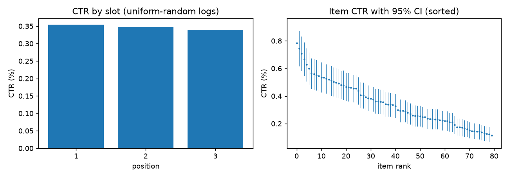
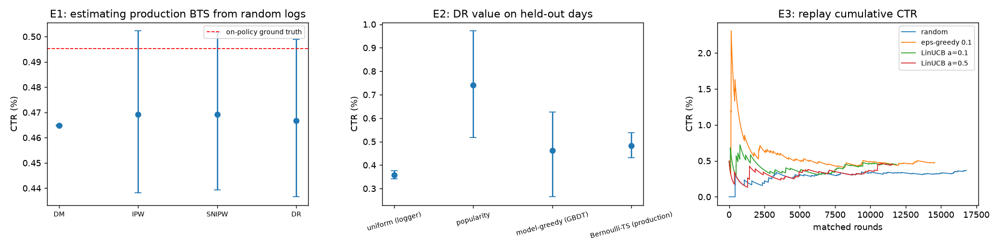

# Off-Policy Evaluation of Recommendation Policies on 1.37M Real Bandit Logs

 

| | |
|---|---|
| **Problem** | Can we rank a new recommendation policy from logs of a different policy before an A/B test? |
| **Verify** | `pytest -q` (no data download) · `results.json` from `scripts/run_experiments.py` (seed 0) · numbers below match that file |
| **CI-ready** | [`ci/github-actions-ci.yml`](ci/github-actions-ci.yml) — enable with `bash scripts/install-github-actions.sh` once `workflow` scope is granted |
| **Status** | Real Open Bandit Dataset; unit tests offline. Full campaign needs the public zip (~15 min). CI written, not enabled. Release example: [`releases/example-obd-seed0.json`](releases/example-obd-seed0.json). |

**Answer (on real data).** Yes, within 5.3–6.1% relative error. Estimates computed only from uniform-random logs land close to the *actual* on-policy CTR of the production policy, and the 95% CIs of IPW, SNIPW and DR cover it. Using those estimators, a simple per-slot popularity policy learned on the first 70% of the week is estimated at **~2.1× the logging policy's CTR** on the held-out 30%.

## Data
[Open Bandit Dataset](https://research.zozo.com/data_release/open_bandit_dataset.zip) (Saito et al., NeurIPS Datasets & Benchmarks 2021; ZOZOTOWN fashion e-commerce; CC BY 4.0). Two campaigns ran in parallel over the same 7 days:

| Log | Policy | Rounds | Clicks | CTR |
|---|---|---:|---:|---:|
| `random/all` | uniform random over 80 items × 3 slots (propensity 1/80) | 1,374,327 | 4,768 | 0.347% |
| `bts/all` | production Bernoulli Thompson Sampling | 12,357,200 | 61,208 | 0.495% |

Context: 4 categorical user features (one-hot, 24 dims) + slot; 80 user–item affinity scores.



EDA: clicks are rare (0.35%), so variance, not bias, is the main enemy. The slot effect is small (0.354% / 0.347% / 0.340% for slots 1–3). Item CTRs range 0.115%–0.784% (median 0.332%), so there is signal to exploit, but many per-item CIs overlap.

## Method
- **Estimators** (`src/cbope/estimators.py`): Direct Method (DM), IPW, self-normalised IPW, Doubly Robust; 95% percentile-bootstrap CIs (200 resamples).
- **Reward model** (`reward_model.py`): gradient-boosted trees on context + item id + user–item affinity, **2-fold cross-fitted** so DR never corrects a row with a model that saw it.
- **Policies** (`policies.py`): uniform, per-slot smoothed popularity, model-greedy argmax, the production BTS policy, and online learners (ε-greedy, **disjoint LinUCB** with Sherman–Morrison updates).
- **Validation design**
  - *E1, estimator validation:* estimate the BTS policy's value from the random logs only; compare with its true on-policy CTR from the BTS logs.
  - *E2, policy selection:* chronological 70/30 split (no look-ahead); learn on the first 70%, evaluate off-policy on the last 412,299 rounds.
  - *E3, online learning:* replay evaluation (Li et al., 2011), unbiased because the logger is uniform.

## Results
Every number below is produced by `scripts/run_experiments.py` (seed 0) and stored in [`results.json`](results.json).

**E1: can we recover a known truth?** Ground truth = 0.4953% (BTS on-policy CTR).

| Estimator | Estimate | 95% CI | Rel. error | CI covers truth |
|---|---:|---|---:|:-:|
| DM | 0.4649% | [0.4647, 0.4651] | 6.1% | ✗ |
| IPW | 0.4692% | [0.4382, 0.5022] | 5.3% | ✓ |
| SNIPW | 0.4692% | [0.4393, 0.5015] | 5.3% | ✓ |
| DR | 0.4667% | [0.4366, 0.4990] | 5.8% | ✓ |

DM is precise but over-confident: its tiny CI excludes the truth, the classic failure of a model-only estimate with no importance-weight correction. The weighted estimators carry honest uncertainty.

**E2: which policy would you ship?** (held-out last 30%; logger's on-policy CTR = 0.3590%)

| Policy | SNIPW | DR (95% CI) |
|---|---:|---|
| uniform (logger) | 0.3590% | 0.3575% [0.3410, 0.3765] |
| **per-slot popularity** | **0.7449%** | **0.7419% [0.5180, 0.9714]** |
| model-greedy (GBDT) | 0.4998% | 0.4631% [0.2649, 0.6263] |
| Bernoulli-TS (production) | 0.4875% | 0.4832% [0.4324, 0.5385] |

The reward model barely beats the base rate on held-out days (AUC 0.626; log-loss 0.02368 vs 0.02380 for a constant), so greedy argmax over it is noisy, and the far simpler popularity policy wins. Its CI is wide because a deterministic policy matches only ~1/80 of logged rounds. I'd treat it as the leading candidate for a confirmatory A/B test, not a shipped result.

**E3: online learners (replay over all 1.37M rounds)**

| Learner | Matched rounds | CTR (95% CI) |
|---|---:|---|
| random | 16,993 | 0.365% [0.271, 0.471] |
| ε-greedy (ε=0.1) | 14,747 | 0.475% [0.353, 0.597] |
| LinUCB α=0.1 | 12,044 | 0.448% [0.332, 0.565] |
| LinUCB α=0.5 | 11,781 | 0.450% [0.331, 0.577] |

The learners' point estimates sit above random, but with 12–17k matched rounds and a 0.35% base rate the CIs overlap. Replay is unbiased but data-hungry, which is why E1–E2 matter.



## Takeaways
1. Off-policy estimates on real logs came within 5–6% of an independent ground truth. Report CIs, not point estimates.
2. Cross-fitted DR ≈ SNIPW here: with uniform logging the importance weights are bounded (≤ 80), so DR's variance reduction is modest.
3. Model complexity didn't pay off: with weak features (AUC 0.63), a smoothed popularity baseline beats a GBDT-greedy policy.

## Reproduce
```bash
pip install -e ".[dev,experiments]"
curl -LO https://research.zozo.com/data_release/open_bandit_dataset.zip && unzip open_bandit_dataset.zip -d data/
PYTHONPATH=src python scripts/run_experiments.py --data data/open_bandit_dataset   # ~15 min
pytest -q                                                                           # unit tests, no data needed
```
`obp` is used only to compute the production BTS policy's action distribution; all estimators, policies and models are implemented in this repo.

## Layout
```
src/cbope/   data.py · estimators.py · reward_model.py · policies.py · replay.py
scripts/     run_experiments.py
tests/       synthetic-data tests: estimator unbiasedness, DR with an oracle model, LinUCB convergence, leakage-free split
figures/     eda.png · results.png
```

## References
Saito et al. (2021) *Open Bandit Dataset and Pipeline*. Li et al. (2010) *A Contextual-Bandit Approach to Personalized News Article Recommendation*. Li et al. (2011) *Unbiased Offline Evaluation of Contextual-bandit-based News Article Recommendation Algorithms*. Dudík et al. (2011) *Doubly Robust Policy Evaluation and Learning*.
